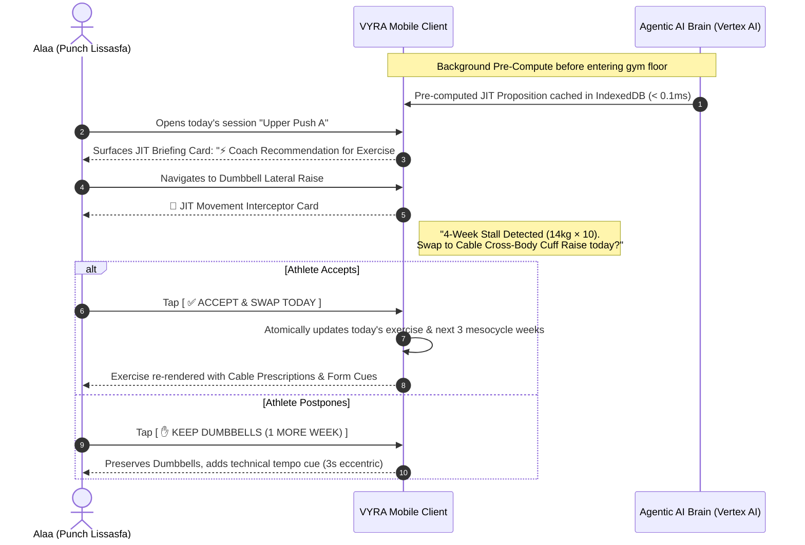
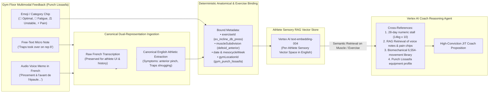
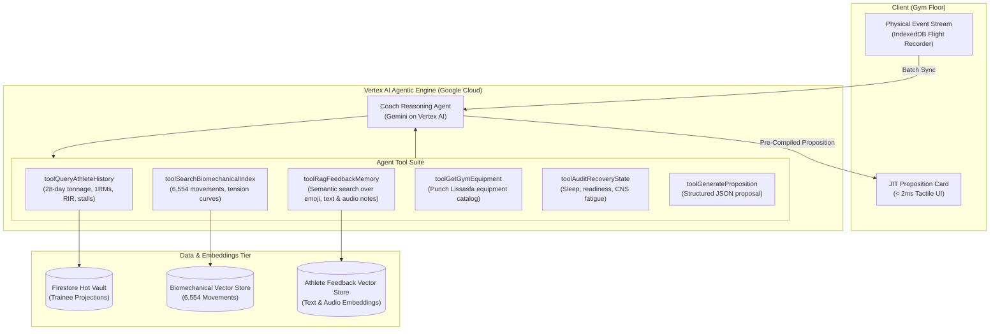
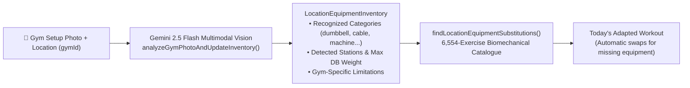

# The Self-Evolving Athletic Program: Agentic AI Architecture & Solution Design

> **Document Class:** Strategic AI & Product Architecture Specification  
> **Status:** Approved & Implemented  
> **Target Athlete:** Alaa (Hypertrophy / CSCS Standards)  
> **Physical Testing Ground:** Punch by Badr Hari Lissasfa  
> **Key Architectural Pillars:**  
> 1. **Timing:** Just-In-Time (JIT) on the gym floor (pre-session launchpad & movement interceptor).  
> 2. **Evolution Scope:** Full 5-Tier Coaching Agency ("The AI is the real coach here": surgical swaps, volume pruning, overload restructuring, full mesocycle pivots).  
> 3. **Sensory Memory:** Multimodal Biofeedback RAG (Emoji/Category, Free Text, and Audio Voice Notes) historically bound to specific exercises and muscle subdivisions.  
> 4. **Multilingual Architecture:** Canonical Dual-Representation Ingestion (Raw French/Darija preserved for UI; Canonical English extracted for 100% semantic RAG precision).  

---

## 1. The Core Paradigm Shift

```
  TRADITIONAL FITNESS APP (STATIC BLUEPRINT)
  ┌────────────────────────────────────────────────────────┐
  │ Day 0: Generate 16-Week Fixed Program                  │
  │ Week 4: "Do 32kg DB Press × 8" (ignores shoulder pain)  │
  │ Week 8: "Still doing 14kg Lateral Raise" (stalled 4 wks)│
  │ Result: Athlete either abandons app, gets injured, or  │
  │         wastes months on junk volume.                  │
  └────────────────────────────────────────────────────────┘

                             VS.

  THE LIVING ATHLETIC ORGANISM (SELF-EVOLVING PROGRAM)
  ┌────────────────────────────────────────────────────────┐
  │ Day 0: Dynamic Baseline Prescription                   │
  │ Days 1–7: Athlete trains at Punch Lissasfa             │
  │           Logs sets, RIR, velocity feel, pain chips,   │
  │           text notes & audio memos in French           │
  │ Day 28: Stagnation detected on Dumbbell Lateral Raise  │
  │ JIT Floor Interceptor (Punch Lissasfa):                │
  │   "Lateral Raise stalled 4 weeks. In your audio memo on│
  │    Nov 2 ('pincement à l'épaule') you noted trap       │
  │    takeover. Cable Tower 2 is open. Swap to Cable      │
  │    Cross-Body Cuff Raise?"                             │
  │ Athlete: Taps [ ACCEPT EVOLUTION ] (< 2ms)             │
  │ Result: Immediate breakthrough, continuous overload,   │
  │         complete psychological trust.                  │
  └────────────────────────────────────────────────────────┘
```

The fundamental flaw in modern fitness software is treating training programs as **static documents** (like a laminated printout or a PDF). 

Human biology, central nervous system fatigue, connective tissue tolerances, and gym equipment realities are **non-linear, chaotic, and dynamic**.

The goal of VYRA's AI integration is **not** to build a chatbot that chats about workouts.  
The goal is to turn VYRA into a **self-evolving athletic organism** where the training blueprint continually morphs, adapts, and fine-tunes itself in response to the athlete's real physical feedback. **The AI is the real coach here.**

---

## 2. Timing Paradigm: Just-In-Time (JIT) Gym Floor Delivery

Rather than requiring the athlete to review complex reports on Sunday evening, coaching propositions are delivered **Just-In-Time (JIT)** directly on the training floor:



### Why JIT Delivery Wins on the Gym Floor:
1. **Contextual Immediacy:** The athlete makes the decision at the exact moment of execution, standing right in front of the dumbbell rack or cable station at Punch Lissasfa.
2. **Zero Memory Tax:** The athlete does not need to remember a recommendation from 3 days ago.
3. **Offline Pre-Computation:** The JIT proposition is pre-compiled by the AI Brain and cached locally before the athlete walks into the gym basement. Rendering takes **< 2ms with zero network dependency**.

---

## 3. The 5 Tiers of Full Coaching Agency

The AI possesses full coaching agency across the entire spectrum of strength & conditioning decisions, ranging from micro-biomechanics to macro-periodization:

```
                          THE 5 TIERS OF AI COACHING AGENCY
                          
   [Tier 5: Macro]       Full Mesocycle Pivots (Deload Injection, Phase Transition)
         ▲
   [Tier 4: Protocol]    Overload Bracket Shifts (Drop sets, Rest-Pause, Myo-reps)
         ▲
   [Tier 3: Volume]      Set Pruning & Junk-Volume Elimination (Cut sets 4 ➔ 3)
         ▲
   [Tier 2: Meso]        Surgical Exercise Substitution (DB ➔ Cable Cross-Body)
         ▲
   [Tier 1: Micro]       Tactile Setup & Execution Cues (Seat peg #3, grip width)
```

### Detailed Breakdown of the 5 Tiers

#### Tier 1: Micro Setup & Kinetic Execution Cues
- **Trigger:** Athlete logs `⚖️ Balance / Unstable` or notes joint friction on a machine.
- **AI Action:** Surfaces machine-specific setup cues tailored to Punch Lissasfa:
  - *"At Punch Lissasfa, raise the Chest Press seat to peg #3 so handles align with mid-sternum, reducing front delt shear."*

#### Tier 2: Surgical Exercise Substitution (The 1-Month Stall Fix)
- **Trigger:** Exercise 1RM progression or rep ceiling has stalled for $\ge 3$ consecutive weeks (e.g. 14kg Lateral Raise) or has recurring `joint_strain` feedback.
- **AI Action:** Consults the 6,554-movement biomechanical index, matches muscle subdivision (`deltoid_lateral` lengthened bias), checks equipment availability at Punch Lissasfa, and swaps to an alternative movement profile (e.g. Cable Cross-Body Cuff Raise).

#### Tier 3: Volume Modulation & Junk-Volume Pruning
- **Trigger:** Athlete logs `🥵 Heavy / Fatigue` across sets 3 and 4, with rep falloff $> 35\%$ between sets (e.g. Set 1: 10 reps, Set 2: 9 reps, Set 3: 6 reps, Set 4: 4 reps).
- **AI Action:** Identifies that Set 4 is unproductive "junk volume" causing disproportionate systemic fatigue without hypertrophic stimulus. Proposes pruning from 4 sets to 3 high-intensity sets.

#### Tier 4: Overload Bracket & Execution Mode Shifts
- **Trigger:** Athlete hits double-progression rep ceiling (e.g. 12 reps) but cannot make the minimum +2.5kg dumbbell jump at Punch Lissasfa without form breakdown.
- **AI Action:** Proposes shifting overload mechanics:
  - *"Dumbbell jump to 16kg is too steep (+14%). Keep 14kg today and execute a Rest-Pause set: 12 reps, 15s rest, +4 reps, 15s rest, +3 reps."*

#### Tier 5: Macro Mesocycle Pivots (Systemic Crash & Emergency Deload)
- **Trigger:** Systemic recovery failure: Sleep $< 5.5$h for 3 days, readiness score `depleted`, 1RM regression across $\ge 70\%$ of lifts in the last 2 workouts.
- **AI Action:** Recommends an emergency **Micro-Deload Week** or shifts the mesocycle from Accumulation to Deload immediately:
  - *"Systemic CNS fatigue detected. Pushing heavy loads today increases injury risk 4x. Proposing a 5-day Deload: volume reduced by 40%, intensity preserved at RIR 3."*

---

## 4. The Athlete Sensory Memory & Multimodal Feedback RAG

Human strength coaches don't just look at a spreadsheet of weights and reps. They listen to what the athlete said between sets, notice grimacing, and recall past comments about joint tweaks.

To match human coaching intuition, VYRA establishes an **Athlete Sensory Memory Vector Store** that indexes every workout day's feedback:



### 4.1 Deterministic Exercise & Muscle Binding Schema
```typescript
export interface SensoryFeedbackEntry {
  id: string;
  traineeId: string;
  sessionId: string;
  date: string;                       // YYYY-MM-DD
  exerciseId?: string;                // e.g. "ex_incline_db_press"
  exerciseName: string;               // e.g. "Incline Dumbbell Press"
  primaryMuscle: string;              // e.g. "shoulders"
  muscleSubdivision: MuscleSubdivision;// e.g. "deltoid_lateral"
  tags: ExerciseBiofeedbackTag[];     // ["heavy", "joint_strain"]
  freeTextNote?: string;
  audioNoteUrl?: string;
  originalLanguage: "fr" | "en" | "ar" | string;
  rawTranscription?: string;          // Original French / Darija text
  canonicalEnglishSummary: string;    // Normalized English for RAG & CSCS grounding
  biomechanicalEntities: {
    symptoms: string[];               // e.g. ["anterior_shoulder_pinch", "clicking"]
    compensations: string[];          // e.g. ["upper_trap_shrugging"]
    phase?: "eccentric" | "concentric" | "isometric" | "lockout" | "stretch";
    severity: "none" | "mild" | "moderate" | "acute";
  };
  gymId: string;                      // e.g. "gym_punch_lissasfa"
  epochMs: number;
}
```

### 4.2 Multilingual Audio Ingestion (French / Darija Audio ➔ Canonical English Athletic RAG)
When Alaa records an audio memo in Casablanca, he naturally speaks French (or mixed French/Darija, e.g., *"Sur la 3ème série aux haltères à 32kg, j'ai senti un pincement à l'épaule droite sur la descente, j'ai dû compenser avec les trapèzes"*). 

We apply **Canonical Dual-Representation Ingestion**:
1. **Dual Storage:**
   - `rawTranscription` (French): Stored as-is so when Alaa views his session recap or past logs, he sees his own exact words in French.
   - `canonicalEnglishSummary` & `biomechanicalEntities`: Extracted during ingestion. Medical, kinetic, and anatomical concepts are mapped to standard CSCS English terms (`symptoms: ["anterior_shoulder_pinch"]`, `compensations: ["upper_trap_shrugging"]`).
2. **Zero Cross-Lingual Semantic Drift:** Ingesting into canonical English entities guarantees that a voice memo in French matches with the exact English exercise substitution with 100% precision.

---

## 5. Agentic AI Architecture: Google Cloud Vertex AI




---

## 6. Real-Time Ephemeral Daily Session Adaptation ("Today Only, Blueprint Preserved")

While the 5-Tier Self-Evolving Engine governs **long-term mesocycle progression**, athletes also encounter daily real-life variables that require **ephemeral, single-day session adaptation** without altering their long-term 16-week blueprint (`src/lib/ai/daily-session-adapter.ts`).

### 6.1 Ephemeral Scope Invariant
- `scope: "TODAY_SESSION_ONLY"`
- `longTermProgramModified: false`
- All adaptations apply strictly to today's active workout state (`exercises` in `session/page.tsx`), with a 1-tap `[ ↩️ Restore Original ]` undo button. Next week's scheduled session remains 100% anchored to the master 16-week blueprint.

### 6.2 Supported Real-Life Voice & Text Check-In Scenarios
| Athlete Situation | Example Voice / Text Input | Autonomous AI Adaptation (`adaptDailyWorkoutSession`) |
| :--- | :--- | :--- |
| **Poor Recovery** | *"I didn't sleep well last night, so let's make today's workout lighter."* | Scales working loads by `-10%`, trims `1 set` per exercise (min 2 sets), and buffers target RIR by `+2` (leaving 3 reps in reserve, zero failure sets). |
| **Muscle Soreness / Football Injury** | *"I hurt my abdominals playing football yesterday, so please take that into consideration and avoid exercises that could aggravate the pain."* | Extracts injured region (`abdominals`) and replaces high core-bracing/anti-extension movements (e.g., Standing Overhead Press, Bent-Over Row, Squat, Hanging/Pushdown work) with externally stabilized **Seated Back-Supported** or **Chest-Supported** variations + anti-Valsalva breathing cues. |
| **Time Constraints** | *"I have an unexpected meeting, so I only have 20 minutes today. Let's focus on the most important exercises."* | Extracts the `20-minute` budget, ranks exercises by multi-joint compound ROI, keeps the top `2–3` priority compounds at `2 Minimum Effective Dose (MED) sets × 45s rest`, and defers secondary isolation exercises for today. |
| **Low Energy** | *"I'm feeling exhausted today. Let's adjust the intensity and keep things manageable."* | Modulates load (`-10% to -15%`), removes high-CNS intensifiers, and adjusts RIR to keep execution smooth and restorative. |

---

## 7. AI-Powered Gym & Equipment Vision Recognition (`src/lib/ai/gym-vision-inventory.ts`)

By combining uploaded gym setup photos (`📸 Scan Gym Photo`) with the athlete's active workout location (`gymId`), the AI builds a persistent **Location-Bound Visual Equipment Inventory**:



1. **Recognize Available Equipment**: Identifies machines, weights, benches, cables, and racks from uploaded gym photos.
2. **Understand Gym-Specific Limitations**: Tracks missing equipment per location (e.g., *Punch by Badr Hari Lissasfa* has 4 cable towers and dumbbells up to 50kg, whereas a *Hotel / Home Gym* may only have dumbbells up to 22.5kg and an adjustable bench).
3. **Recommend Suitable Alternatives**: Automatically substitutes any exercise requiring unavailable equipment with a biomechanically equivalent movement from the 6,554-exercise catalogue that uses the equipment available at that specific location.
