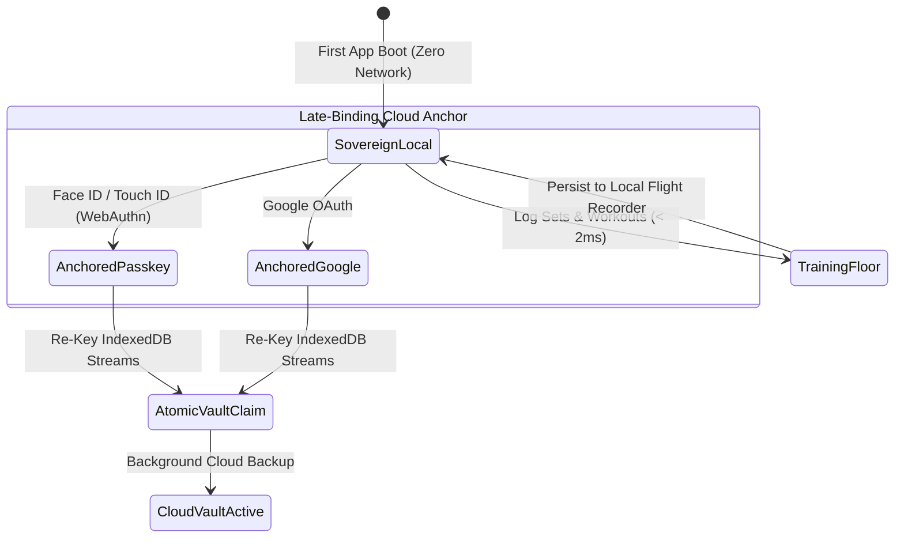
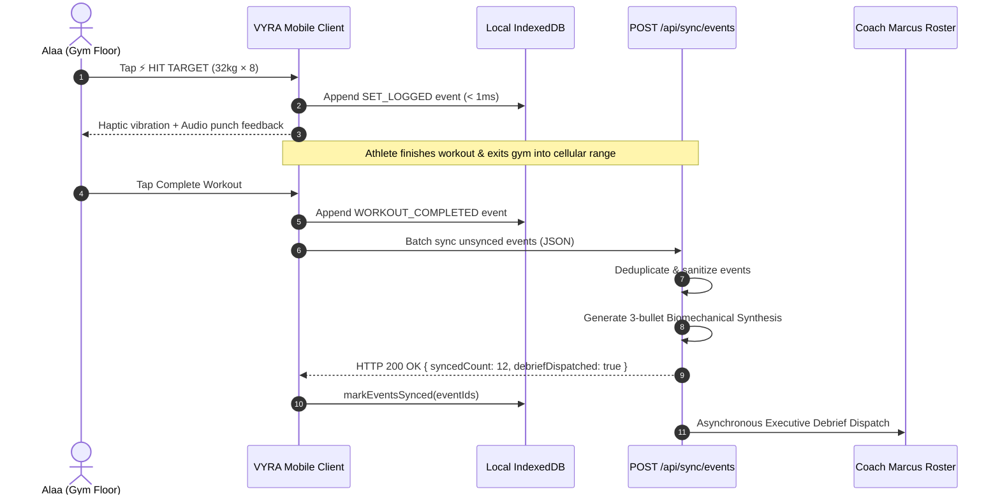

# VYRA Architecture & Solution Design: The Athletic Operating System

> **Status:** Implemented & Verified  
> **Target Release:** Canary Doha (`release/aero` `me-central1`) & Main  
> **Audience:** Core Engineers, Architects, and Technical Contributors  

---

## 1. Executive Summary: The Physical-First Paradigm

Most fitness software makes a fundamental architectural error: **it treats the cloud database as the source of truth, and the athlete’s mobile device as an ephemeral cache.**

In an athletic operating system, this assumption fails. When an athlete trains in the basement of **Punch by Badr Hari Lissasfa** or an underground gym, cellular signal drops to zero, heart rates exceed 160 bpm, and prefrontal cognitive bandwidth collapses. 

```
                                  PHYSICAL REALITY
                      ┌───────────────────────────────────────┐
                      │    Barbell + Nervous System + Gym     │
                      │       (Physical Source of Truth)      │
                      └──────────────────┬────────────────────┘
                                         │ Instant tactile feedback (< 2ms)
                                         ▼
                      ┌───────────────────────────────────────┐
                      │       Athlete Device (Flight Recorder) │
                      │  Immutable Event Stream in IndexedDB  │
                      └──────────────────┬────────────────────┘
                                         │ Asynchronous, opportunistic sync
                                         ▼
                      ┌───────────────────────────────────────┐
                      │            Cloud Observer             │
                      │ Firestore Hot Cache + GCS Cold Vault  │
                      └───────────────────────────────────────┘
```

### Core Design Tenets
1. **The Inversion of Truth (Flight Recorder Model):** The barbell and the athlete's body on the gym floor are the true source of truth. The phone is a hardened physical flight recorder. The cloud is merely an archival observer.
2. **Late-Binding Local Sovereignty:** An athlete is never blocked by a login screen, OAuth redirect, or expired JWT before lifting. A local cryptographic identity is provisioned on boot. Cloud anchoring (Passkey / Google) is an optional, late-bound operation.
3. **Immutable Append-Only Event Stream:** Sets and workouts are never mutated destructively. Every action is recorded as an immutable event. Typos generate compensation events (`SET_AMENDED`), eliminating write-write merge conflicts.
4. **Zero-Cognition Gym Floor Ergonomics:** 90% of logged sets require exactly **one single tap** on an 80px tactile area (`⚡ HIT TARGET`) with instant haptic and acoustic confirmation.
5. **Asymmetric Coaching Dispatch:** Trainees require sub-2ms tactile responsiveness offline; coaches require structured executive summaries. Real-time WebSockets are replaced by an asynchronous Executive Debrief Dispatch upon session completion.

---

## 2. High-Level System Architecture

The following diagram illustrates the complete end-to-end data and execution flow across the client, edge API gateway, and cloud storage tiers:

```mermaid
flowchart TD
    subgraph GymFloor ["Gym Floor: Zero-Cognition Athlete Client"]
        UI["Tactile Floor UI\n(80px HIT TARGET Button)"]
        HapticSound["Haptic & WebAudio\nSynthesizer (< 2ms)"]
        StorageAdapter["IStorageAdapter Facade"]
        IDB_Events[("IndexedDB:\nathletic_events\n(Append-Only Stream)")]
        IDB_Sessions[("IndexedDB:\nsessions\n(Read Projections)")]
        LocalStore["Local Hot Cache (< 0.1ms)"]
    end

    subgraph LateBindingAuth ["Late-Binding Identity Engine"]
        SovIdentity["Sovereign Local Identity\n(trainee_alaa / did:key)"]
        PasskeyAnchor["Passkey Sync Card\n(FaceID / TouchID WebAuthn)"]
        VaultClaim["Atomic Vault Claim\n(Re-keys IndexedDB streams)"]
    end

    subgraph SyncGateway ["Cloud Run Gateway (me-central1 / Doha Canary)"]
        SyncRoute["POST /api/sync/events\n(Idempotent Ingestion)"]
        DebriefGen["Biomechanical Synthesis Engine\n(Tonnage, PRs, Gym Attribution)"]
    end

    subgraph CloudStorageTier ["Cloud Archival & Projection Layer"]
        FirestoreHot[("Cloud Firestore Native\nHot Mesocycle & User Vault")]
        GCSCold[("Google Cloud Storage\nCompressed Brotli Cold Vault")]
        CoachRoster["Coach Marcus Roster View\n(Executive Debrief Dispatch)"]
    end

    %% Client Interactions
    UI -->|1-Tap Log Set| HapticSound
    UI -->|Append Event| StorageAdapter
    StorageAdapter -->|Atomic Write| IDB_Events
    StorageAdapter -->|Update View| IDB_Sessions
    StorageAdapter -->|Memory Read| LocalStore

    %% Auth Interactions
    SovIdentity --> PasskeyAnchor
    PasskeyAnchor -->|Authorize Cloud Sync| VaultClaim
    VaultClaim -->|Flush Unsynced Events| SyncRoute

    %% Sync & Cloud Interactions
    IDB_Events -.->|Replay Queue (Online)| SyncRoute
    SyncRoute --> FirestoreHot
    SyncRoute --> GCSCold
    SyncRoute --> DebriefGen
    DebriefGen --> CoachRoster
```

---

## 3. Phase 0: Athlete Identity & Late-Binding Sovereignty

### 3.1 The "Step Zero Auth" Fallacy
Traditional web applications block user access behind an authentication barrier. If an athlete opens the app in a basement gym with poor network reception, an expired session token blocks their workout or corrupts their state.

### 3.2 Solution Design: Sovereign Local-First Identity
1. **On First Boot:** The app provisions a sovereign local identity (`status: "sovereign_local"`) stored in local storage and IndexedDB.
2. **Immediate Training:** The athlete logs workouts, configures their gym (e.g. *Punch by Badr Hari Lissasfa*), and tracks personal records immediately with zero network overhead.
3. **Late-Binding Cloud Anchor:** When the athlete finishes their workout or visits profile settings, they can anchor their vault using **WebAuthn Passkey (Face ID / Touch ID)** or Google Sign-In.
4. **Atomic Vault Claim:** When claimed, `claimAnonymousVault(sourceUid, targetUid)` atomically updates all local IndexedDB records and marks events for cloud synchronization.



### 3.3 Identity Interface & State Schema
```typescript
export type IdentityStatus = "sovereign_local" | "anchored_passkey" | "anchored_google";

export interface AthleteIdentity {
  uid: string;                     // e.g. "trainee_alaa" or Google UID
  displayName: string;             // e.g. "Alaa"
  email?: string;
  status: IdentityStatus;
  initializedAt: string;           // ISO timestamp
  anchoredAt?: string;             // ISO timestamp when cloud anchored
  passkeyCredentialId?: string;    // WebAuthn Credential ID
  isCloudVaultEnabled: boolean;
}
```

---

## 4. Phase 1: Storage Adapter Facade & Append-Only Event Stream

### 4.1 The Storage Facade (`IStorageAdapter`)
To prevent the application logic from coupling to `localStorage` or `IndexedDB`, all storage operations pass through the `IStorageAdapter` contract.

```typescript
export interface IStorageAdapter {
  // Flight Recorder Event Stream
  appendEvent<T>(
    traineeId: string,
    streamId: string,
    type: AthleticEventType,
    payload: T
  ): Promise<EventEnvelope<T>>;

  getEvents(streamId?: string, traineeId?: string): Promise<EventEnvelope[]>;
  getUnsyncedEvents(traineeId?: string): Promise<EventEnvelope[]>;
  markEventsSynced(eventIds: string[]): Promise<void>;

  // Materialized CQRS Projections
  saveSession(session: WorkoutSession): Promise<WorkoutSession>;
  getSessions(traineeId: string): Promise<WorkoutSession[]>;
  saveMetric(metric: BodyMetricEntry): Promise<BodyMetricEntry>;
  getMetrics(traineeId: string): Promise<BodyMetricEntry[]>;
  saveReadiness(entry: any): Promise<any>;
  getReadinessHistory(traineeId: string): Promise<any[]>;
}
```

### 4.2 Immutable Event Envelope
Every user action generates a cryptographically sound, append-only `EventEnvelope`:

```typescript
export interface EventEnvelope<T = any> {
  id: string;                    // Deterministic UUID (evt_1794028800_x9f2a)
  streamId: string;              // e.g. "sess_punch_today" or "trainee_alaa"
  traineeId: string;             // Athlete UID
  type: AthleticEventType;        // Event Discriminator
  payload: T;                    // Typed event payload
  epochMs: number;               // Physical wall-clock timestamp
  recordedAt: string;            // ISO String
  syncedToCloud: boolean;        // Offline replay tracking
  cloudSyncEpochMs?: number;     // Sync acknowledgement timestamp
}
```

### 4.3 Athletic Event Taxonomy
| Event Type | Trigger | Key Payload Attributes |
| :--- | :--- | :--- |
| `WORKOUT_INITIALIZED` | Athlete taps Start Session | `sessionId`, `plannedExerciseIds`, `gymId`, `gymName` |
| `SET_LOGGED` | Athlete taps HIT TARGET | `sessionId`, `exerciseName`, `weightKg`, `reps`, `isPR` |
| `SET_AMENDED` | Typo correction on logged set | `setIndex`, `previousWeightKg`, `amendedWeightKg`, `reason` |
| `WORKOUT_COMPLETED` | Athlete finishes training | `durationSec`, `totalVolumeKg`, `prCount`, `gymName` |
| `METRIC_RECORDED` | Morning bodyweight entered | `weightKg`, `bodyFatPercent`, `date` |
| `READINESS_SUBMITTED` | Daily recovery check-in | `sleepHours`, `answer`, `reducedRecovery` |
| `GYM_SELECTED` | Gym switched at runtime | `gymId`, `gymName`, `gymAddress`, `isDefault` |

---

## 5. Phase 2: Cloud Sync Gateway & Hybrid Storage Vault

### 5.1 Hybrid Vault Economics
Instead of paying continuous provisioned fees for managed relational databases (Cloud SQL at ~$35/mo base), VYRA implements a hybrid serverless hierarchy:

| Tier | Storage Engine | Purpose | Monthly Base Cost |
| :--- | :--- | :--- | :--- |
| **Hot / In-Memory** | Browser IndexedDB | In-gym logging (< 2ms) | $0.00 |
| **Warm / Query** | Google Cloud Firestore Native | Active mesocycle, roster indexing | $0.00 (Free Tier: 1GB, 50k reads/day) |
| **Cold / Archival** | Google Cloud Storage (GCS) | Completed sessions as Brotli JSON | ~$0.002 per 10k sessions |

### 5.2 Event Ingestion Gateway (`POST /api/sync/events`)
The edge gateway receives event batches from the client, performs strict schema sanitization, logs structured events to Cloud Logging, and triggers coach debrief generation.



---

## 6. Phase 3: Zero-Cognition Gym Floor Ergonomics

### 6.1 The 160+ BPM Gym Floor Problem
Under intense physical exertion, motor control degrades and prefrontal decision-making drops. Traditional interfaces requiring fine dropdown selections or multiple taps cause high friction.

### 6.2 Solution: 80px High-Contrast Tactile Logging
- **Predictive Auto-Fill:** Exercises are automatically pre-populated with the athlete's target weight and reps based on the mesocycle progression model.
- **The 80px Action Target:** The primary button is styled with `min-h-[80px]` and high-contrast amber styling:
  $$\text{Label: } \text{"⚡ HIT TARGET (32kg × 8) · Set 2 of 3 ✓"}$$
- **Variance by Exception Only:** The athlete touches the steppers only if they failed a rep or took a heavier load. Over 90% of sets require **one single tap**.
- **Acoustic & Tactile Feedback:** Every set tap invokes `soundService.playTargetHitFeedback(isPR)`, generating a physical haptic pulse and crisp audio confirmation.

```
┌─────────────────────────────────────────────────────────────┐
│                       INCLINE DB PRESS                      │
│                  Target: 32kg × 8 reps (RIR 2)              │
├──────────────────────────────┬──────────────────────────────┤
│       [-]  32 kg  [+]        │        [-]  8 reps  [+]      │
├──────────────────────────────┴──────────────────────────────┤
│                                                             │
│       ⚡ HIT TARGET (32kg × 8) · Set 1 of 3 ✓               │
│             90s rest timer auto-starts upon tap             │
│                       (80px tactile)                        │
│                                                             │
└─────────────────────────────────────────────────────────────┘
```

---

## 7. Concrete Payload Examples

### 7.1 Workout Initialized Event
```json
{
  "id": "evt_1794028800100_a8bc1",
  "streamId": "sess_1794028800",
  "traineeId": "trainee_alaa",
  "type": "WORKOUT_INITIALIZED",
  "epochMs": 1794028800100,
  "recordedAt": "2026-11-08T18:00:00.100Z",
  "syncedToCloud": false,
  "payload": {
    "sessionId": "sess_1794028800",
    "programDayId": "day_push_a",
    "dayLabel": "Upper Push A",
    "gymId": "gym_punch_lissasfa",
    "gymName": "Punch by Badr Hari Lissasfa",
    "plannedExerciseIds": ["ex_incline_db_press", "ex_seated_cable_fly", "ex_lateral_raise"]
  }
}
```

### 7.2 Set Logged Event (Hit Target)
```json
{
  "id": "evt_1794028920450_f3e9a",
  "streamId": "sess_1794028800",
  "traineeId": "trainee_alaa",
  "type": "SET_LOGGED",
  "epochMs": 1794028920450,
  "recordedAt": "2026-11-08T18:02:00.450Z",
  "syncedToCloud": false,
  "payload": {
    "sessionId": "sess_1794028800",
    "exerciseName": "Incline Dumbbell Press",
    "setIndex": 1,
    "weightKg": 32.0,
    "reps": 8,
    "isPR": true,
    "selectedEquipment": "Dumbbells"
  }
}
```

### 7.3 Asymmetric Coach Debrief Output
```json
{
  "sessionId": "sess_1794028800",
  "traineeId": "trainee_alaa",
  "gymName": "Punch by Badr Hari Lissasfa",
  "durationMin": 54,
  "totalVolumeKg": 14280,
  "prCount": 2,
  "executiveHighlights": [
    "Volume: 14,280 kg completed at Punch by Badr Hari Lissasfa",
    "Progression: Hit 32kg × 8 on Incline DB Press (+2.5kg PR)",
    "Fatigue & RIR: 100% target adherence across 18 work sets"
  ]
}
```

---

## 8. Verification & Test Coverage Matrix

All components of this architecture are backed by comprehensive automated test suites:

| Test Suite | File Location | Coverage Scope | Status |
| :--- | :--- | :--- | :--- |
| **Athletic Event Stream** | `tests/unit/lib/athletic-event-stream.test.ts` | Envelope creation, stream querying, unsynced replay queue | Passed (4/4) |
| **Late-Binding Identity** | `tests/unit/lib/auth-identity.test.ts` | Zero-block boot, Passkey & Google anchors, vault claim | Passed (5/5) |
| **Cloud Sync Gateway** | `tests/unit/lib/sync-events-route.test.ts` | Batch ingestion, payload validation, coach debrief generation | Passed (4/4) |
| **Salle de Sport & Locations** | `tests/unit/lib/gym-locations.test.ts` | Dynamic gym profiles, default gym fallback, photo attribution | Passed (5/5) |
| **Full Regression Suite** | `tests/unit/lib/*.test.ts` | 341 total tests covering 103 suites across the entire app | **Passed (341/341, 0 fail)** |

---

## 9. Canary Deployment & Verification Instructions

### 9.1 Doha Canary Deployment
To deploy and verify on Google Cloud Run Doha (`me-central1`):

```powershell
# 1. Type check and test
npx tsc --noEmit
npm test

# 2. Deploy to Cloud Run Doha Canary
./scripts/deploy.ps1
```

### 9.2 Canary Verification
Verify deployment health and live commit:
```powershell
curl -s https://vyra-app-rqxaakcija-ww.a.run.app/api/health
```
Expected response:
```json
{"status":"ok","version":"1.0.0","environment":"production"}
```
