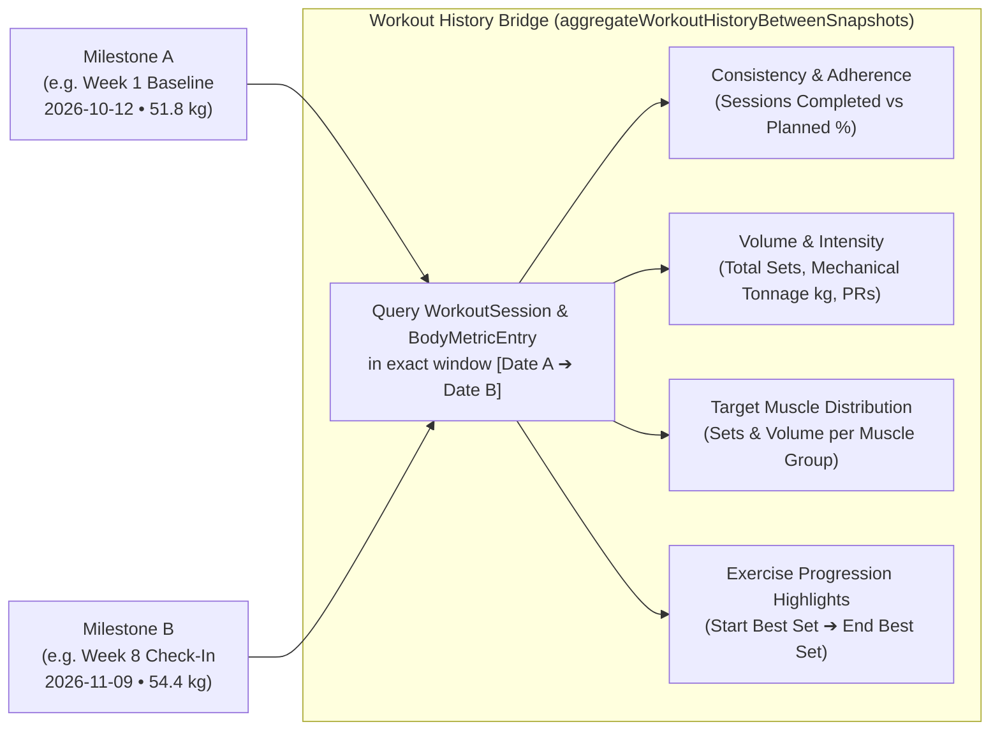
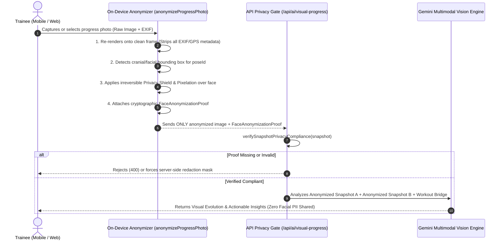

# AI-Powered Visual Progress Tracking: Customer Journey, Privacy-First Vision & Workout Correlation Architecture

> **Document Class:** Product Experience, Customer Journey & AI Architecture Specification  
> **Status:** Approved & Implemented  
> **Primary Modules:**  
> - Engine & Privacy Pipeline: [`src/lib/ai/visual-progress.ts`](../../src/lib/ai/visual-progress.ts)  
> - API Route: [`src/app/api/ai/visual-progress/route.ts`](../../src/app/api/ai/visual-progress/route.ts)  
> - Interactive Studio UI: [`src/components/trainee/VisualProgressStudio.tsx`](../../src/components/trainee/VisualProgressStudio.tsx)  
> - Integrated Workspace: [`src/app/(trainee)/progress/page.tsx`](../../src/app/(trainee)/progress/page.tsx)  

---

## 1. Empathy & The Emotional Customer Journey: Why Traditional Progress Photos Fail

```
  THE TRADITIONAL "PROGRESS PHOTO" TRAP
  ┌──────────────────────────────────────────────────────────────────┐
  │ 1. The Daily Mirror Illusion ("Boiling Frog" Effect):            │
  │    Seeing yourself every day masks 4-week micro-adaptations.     │
  │ 2. Unstandardized Angles & Lighting:                             │
  │    Random bathroom selfies distort proportions and cause         │
  │    false discouragement ("Did I lose muscle or is it lighting?") │
  │ 3. Privacy & Vulnerability Anxiety:                              │
  │    Trainees refuse to upload identifiable face+body photos to    │
  │    external cloud AI models.                                     │
  │ 4. Disconnected from the Work:                                   │
  │    Two photos side-by-side don't explain *why* a change happened │
  │    or *what* training adjustment to make next.                   │
  └──────────────────────────────────────────────────────────────────┘

                                 VS.

  THE VYRA ASPIRATIONAL VISUAL EVOLUTION JOURNEY
  ┌──────────────────────────────────────────────────────────────────┐
  │ 1. Standardized 4-Pose Protocol & Cadence (Weekly / Biweekly):   │
  │    Guided camera height, foot stance, and diaphragmatic breath.  │
  │ 2. On-Device Face Anonymization BEFORE Storage or AI Analysis:   │
  │    Cranial/facial region is blurred/masked on-device & EXIF      │
  │    scrubbed. Zero facial PII ever reaches an external LLM.       │
  │ 3. "The Work Behind the Frame" Workout History Bridge:           │
  │    Comparing Milestone A (W1) and Milestone B (W8) automatically │
  │    aggregates every session, exercise, set, tonnage, PR, and     │
  │    consistency metric logged between those exact dates.          │
  │ 4. Micro-Win Recognition & 1-Tap Program Evolution:              │
  │    Highlights subtle postural & muscular shifts and offers       │
  │    1-tap reversible program adjustments for the next block.      │
  └──────────────────────────────────────────────────────────────────┘
```

---

## 2. Pillar 1: Standardized Visual Progress Tracking

Meaningful visual comparison requires eliminating camera, stance, and breathing noise. VYRA defines **four canonical biomechanical check-in postures** (`STANDARDIZED_POSE_GUIDES`):

| Pose ID | Canonical Label | Camera & Stance Standardization | Primary Visual & Postural Signals Tracked |
| :--- | :--- | :--- | :--- |
| `front_relaxed` | **Front Anatomical Relaxed** | Mid-sternum camera height, 1.8m distance, feet hip-width, arms relaxed 15° off torso, natural exhale | Clavicular width, lateral deltoid cap rounding, upper clavicular chest shelf, waist-to-shoulder V-taper, left/right shoulder symmetry |
| `side_posture` | **Right Lateral Posture Profile** | Mid-torso height, 90° perpendicular to right side, weight 60% on heels, glutes lightly engaged | Pelvic tilt alignment (Anterior Pelvic Tilt reduction), rib-cage stacking over pelvis (rib flare control), thoracic extension, chest projection |
| `back_relaxed` | **Posterior Scapular Spread** | Mid-scapula height, 1.8m distance, shoulder blades resting naturally depressed | Latissimus dorsi V-taper sweep, lower trapezius & rhomboid density, rear deltoid fullness, scapular levelness |
| `front_double_biceps` | **Front Aspirational Flex** | Mid-sternum height, elbows elevated slightly above shoulder plane, core wall locked | Biceps peak & brachialis fullness, left-vs-right arm symmetry, serratus anterior & upper lat flare |

### Timeline & Milestone Architecture
- **Configurable Cadence**: Trainees choose `weekly`, `biweekly`, or `monthly` check-in intervals.
- **Timestamped Milestone Nodes**: Every snapshot is anchored to an ISO date (`YYYY-MM-DD`), mesocycle week (`weekIndex`), body weight (`weightKg`), and standardization quality scores (`lightingScore`, `postureAlignmentScore`).
- **Any-to-Any Milestone Matrix**: Trainees can compare Day 1 Baseline against Today, or compare adjacent 4-week mesocycle blocks (`Milestone A` vs `Milestone B`).

---

## 3. Pillar 2: Connecting Visual Progress to Workout History ("The Work Behind the Frame")

A side-by-side photo comparison only becomes truly motivating and educational when connected to the physical work that produced it.



When the trainee selects **Picture A** and **Picture B**, `aggregateWorkoutHistoryBetweenSnapshots()` automatically computes:
1. **Training Consistency**: Total sessions completed, planned sessions in that date window, and adherence percentage (`consistencyPercent`).
2. **Mechanical Volume & PRs**: Total working sets completed, cumulative tonnage lifted (`totalVolumeKg`), and Personal Records (`prsUnlocked`) broken during that exact interval.
3. **Target Muscle Group Breakdown**: Aggregates sets, tonnage, and share percentage across muscle groups (`Upper & Sternal Chest`, `Lats & Upper Back`, `Lateral & Side Deltoids`, `Rear Delts & Scapular Retractors`, `Lower Body & Posterior Chain`, `Arms`).
4. **Top Exercise Progression Highlights**: Shows the exact lifts that drove the visual evolution, including starting best set vs. ending best set and total tonnage.

---

## 4. Pillar 3: Privacy-First Face Anonymization Preprocessing

We do not need facial identity to evaluate clavicular width, deltoid capping, V-taper, or pelvic alignment—and identifiable faces must **never** be shared with external LLMs or vision endpoints.



### Privacy Invariants Enforced in Code:
- **Zero EXIF Leakage**: Drawing onto an offscreen canvas (`on_device_canvas_blur`) or wrapping in an anonymized SVG mask (`svg_privacy_shield`) strips camera serial numbers, timestamps, and GPS coordinates.
- **Irreversible Cranial Masking**: The normalized bounding box covering the head/face (`y: 3%–21%`) is permanently masked with an obsidian privacy shield before storage or network transmission.
- **Hard API Guardrail**: `verifySnapshotPrivacyCompliance()` validates `isAnonymized === true`, `scrubbedExif === true`, and non-zero bounding box dimensions before `analyzeVisualProgressEvolution()` executes.

---

## 5. Pillar 4: Autonomous Gemini 4 Argon Multimodal Synthesis & 1-Tap Program Evolution

Powered by **Gemini 4 Argon (`gemini-4-argon`)** at `visionMediaResolution: "high"`, the AI synthesis engine (`analyzeVisualProgressEvolution`) inspects both privacy-anonymized milestone images (`extractMultimodalSnapshotPart`) alongside the workout history bridge (`VISUAL_EVOLUTION_RESPONSE_SCHEMA`) to autonomously generate four structured outputs:

1. **Empathetic Headline & Executive Narrative**: Speaks directly to the athlete's effort (e.g., *"Your consistency is visibly reshaping your frame: 12 workouts and 48,500 kg lifted between Week 1 Baseline and Week 8 Check-In drove a +12% upper-frame expansion and +15 pt posture upgrade"*).
2. **Autonomous Multi-Tier Visual Observations (`VisualChangeObservation[]`)**:
   - `major` / `moderate`: Primary muscle hypertrophy, contour expansion, and lean body mass vs. adipose partitioning.
   - `posture_alignment`: Reductions in anterior pelvic tilt, lower-costal rib-cage flare, and left-to-right acromial shoulder asymmetry.
   - `subtle_micro` (**The Micro-Win & Growth Potential Detector**): Highlights subtle proportion shifts and identifies under-stimulated muscle groups with the highest next-block growth potential.
3. **Causal Training-to-Physique Links**: Explicitly pairs each observed visual change with the exact sets, exercises, load progression, and adherence rate that caused it.
4. **Actionable 1-Tap Program Adjustments (`ProgramAdjustmentSuggestion[]`)**:
   - Autonomously proposes next-block exercise swaps, corrective sets, or volume modulations tailored to the visual scan findings (e.g., swapping `Standing Dumbbell Lateral Raise` to `Behind-the-Back Cable Cuff Lateral Raise` for lengthened-bias side delt tension).
   - Adheres strictly to **Vyra Law 11 (Show Reasoning, Keep Control)**: 1-tap `[ Apply Adjustment to My Program ]` mutates the active program in `appStore` and immediately turns into a 1-tap `[ Applied to Program ✓ (Tap to Undo) ]` control.
