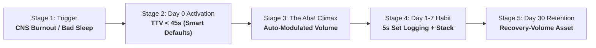

# Customer Journey Architecture: The Adaptive Hypertrophy Wedge

> **Directive Source**: Phase 1 of Founder Operating System (`startup-strategy-advisor`, `founder-operating-system`).  
> **Status**: APPROVED ARCHITECTURE  
> **Scope**: The Train Pillar Wedge (Sole validation target prior to multi-pillar expansion).

---

## 🎯 1. ICP Definition & Anti-Persona Boundaries

### The Desperate ICP: "The Structured Hypertrophy Trainee" (Archetype: "Alaa")
- **Role/Demographic**: Serious lifter (2–7 years lifting experience, 22–38 years old), working professional or technical founder with high discipline and cognitive load.
- **Current Struggle**: Following a structured 12–16 week hypertrophy block (RP, Jeff Nippard, John Meadows, or custom coach program). Logs every set, tracks RIR (Reps in Reserve), and follows an 8-supplement daily stack. 
- **The Acute Breaking Point**: Rigid trackers (Hevy, Strong, Excel) assume 100% recovery every day. When they sleep 5 hours or travel, the app still demands a PR attempt. The lifter either overtrains, risks injury, or manually calculates modified warmups and accessory drops in their head between meetings.
- **Emotional State**: Frustrated by blind rigidity; wants elite coaching logic without paying $250/month for an asynchronous human coach who replies 24 hours too late.
- **Buying Power**: Already pays $50–$150/year for gym memberships, supplements ($100+/mo), lifting straps, and fitness app subscriptions.

### The Explicit Anti-Persona: "The Casual Wellness Dabbler"
- **Profile**: Wants a "lifestyle vibe check", tracks hydration once a week, looks for aesthetic mood boards and generic streak badges.
- **Why We Refuse Them**: They bounce immediately off high-density logging (RIR, load, tempo). Serving them leads to feature creep (meditation timers, water reminders, generic motivational quotes) that destroys the cognitive utility for the serious lifter.

---

## 🗺️ 2. The 5 Customer Journey Milestones

---

### Stage 1: The Trigger & Awareness (The Bleeding Neck)
* **The External Catalyst**: The lifter had 5 hours of broken sleep due to work or travel. Today is Leg Day (Heavy Squats).
* **The Competitor Failure**:
  * *Hevy / Strong*: Opens app $\rightarrow$ Demands 315 lbs $\times$ 5 reps at RIR 1. Lifter feels dread or fails rep 4.
  * *Coach Spreadsheet*: Lifter doesn't want to text their coach at 6:30 AM asking *"I slept poorly, what should I change?"*
* **The Inbound Hook**: *"Your lifting program, adapted in 5 seconds to how you actually recovered today."*

---

### Stage 2: Day 0 Frictionless Activation (TTV $< 45$ Seconds)
* **Anti-Pattern Excluded**: No 12-screen onboarding surveys asking for birthday, target body fat, favorite gym music, or notification permissions upfront.
* **The Frictionless Flow**:
  1. **Landing (0–10s)**: 1 Tap: *"Select Program Type"* (Options: *Upper/Lower Hypertrophy*, *Push/Pull/Legs*, or *Paste Custom Exercises*).
  2. **Smart Readiness Prompt (10–20s)**: A single tactile slider: *"How did you sleep last night?"* (Defaults to *5h 30m / Sub-optimal* to immediately demonstrate adaptation).
  3. **Launch Preview (20–30s)**: Instant display of today's adapted workout sheet.

---

### Stage 3: The "Aha!" Moment (The Value Climax)
* **The Screen**: Today's Workout Preview Header & Exercise Table.
* **The Data Point**: The lifter sees the **Adaptive CNS Delta**:
  > **Target Recalibration**:  
  > *Barbell Back Squat*: Set 3 dropped from 315 lbs $\rightarrow$ 295 lbs (RIR preserved at 2).  
  > *Volume Compensation*: 1 set shifted to Hack Squat machine (axial spinal load reduced by 40%).  
  > *Rationale Pill*: `Sleep 5.5h detected · Spinal fatigue mitigated · Hypertrophy stimulus matched`.
* **The Mental Shift**: *"This app thinks like an intelligent strength coach sitting next to me on the bench."*

---

### Stage 4: Day 1–7 Core Habit Loop
* **Natural Cadence**: 4–5 training days per week + daily morning/evening supplement check.
* **The Logging Flow (Under 5 Seconds per Set)**:
  * Open active session $\rightarrow$ Previous weight & reps pre-filled.
  * Adjust reps if needed with single-tap stepper $\rightarrow$ Tap `Log Set`.
  * Rest timer kicks in automatically with haptic feedback.
* **The Ambient Signal**:
  * Post-workout trigger: *"Session logged (Volume: 14,200 kg). Take Post-Workout Stack: 5g Creatine + 40g Whey."* (1-tap complete).

---

### Stage 5: Day 30 Retention & Compounding Asset
* **The Data Moat**: After 20 logged sessions across varying sleep/readiness states, the app computes the user's **Personalized Readiness-to-Volume Response Curve**:
  * *"You maintain 92% pressing strength on <6h sleep, but your posterior chain drops by 18%. Your volume is now automatically customized to this biometric fingerprint."*
* **Switching Cost**: Moving back to Hevy or a static spreadsheet means losing an intelligent training engine that knows their personal fatigue tolerance.
