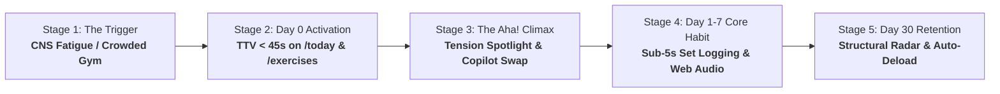

# Customer Journey Architecture: The Autonomous Biomechanical Engine

> **Directive Source**: Founder Operating System Framework (`startup-strategy-advisor`, `founder-operating-system`)  
> **Target Alignment**: The Structured Hypertrophy Trainee ("Alaa")  
> **Route Integration**: Live Compiled Next.js Routes (`/today`, `/exercises`, `/session`, `/posture`, `/progress`, `/program`, `/coach`)  
> **Status**: APPROVED STRATEGIC JOURNEY ARCHITECTURE  

---

## 1. ICP Definition & Anti-Persona Boundaries

### The Desperate ICP: The Structured Hypertrophy Trainee (Archetype: "Alaa")
- **Profile**: Experienced, disciplined lifter (2–7 years serious lifting experience, 24–42 years old); corporate professional, software engineer, or technical founder navigating high cognitive workloads and strict schedules.
- **Current Struggle**: Executing a structured 12–16 week periodized hypertrophy program (e.g. 2:1 pull-to-push postural balance, side delt specialization, or compound progression). Logs every set, monitors RIR (Reps in Reserve), and adheres to daily hydration and supplement milestones.
- **The Acute Breaking Point**:
  - Rigid tracking apps (Hevy, Strong) assume 100% neuromuscular recovery every single day. When the lifter gets 5 hours of sleep, travels across time zones, or enters a packed basement gym with occupied equipment, traditional apps demand impossible PR attempts or freeze without cellular reception.
  - Generic AI apps (Fitbod) generate random, disconnected workout variations that destroy periodized progressive overload.
  - Trainees are forced to either risk joint injury or perform mental arithmetic between meetings.
- **Emotional State**: Frustrated by blind rigidity; demands elite sports science logic and sub-5s execution without paying $250+/month for an asynchronous human coach who replies 24 hours too late.
- **Willingness to Pay**: Readily invests in high-yield tools ($50–$150/year gym memberships, $100+/mo supplements, lifting straps, and premium software).

### The Explicit Anti-Persona: The Casual Wellness Dabbler
- **Profile**: Seeks aesthetic mood boards, generic motivational streaks, and superficial lifestyle reminders.
- **Why We Reject Them**: They bounce immediately off high-precision athletic metrics (RIR, load velocity, Poliquin benchmark ratios). Accommodating them introduces feature creep (water popups, meditation timers, social feeds) that destroys the core utility for the serious lifter.

---

## 2. The 5 Strategic Customer Journey Stages

---

### Stage 1: The Trigger & Awareness (The Acute Point of Failure)

- **The External Catalyst**: The trainee experienced 5 hours of broken sleep due to work deliverables. Today is scheduled as a heavy chest & shoulder hypertrophy day.
- **The Competitor Breakdown**:
  - *Hevy / Strong*: Opens the app $\rightarrow$ Blindly demands a 90kg barbell bench press at RIR 1. The trainee feels joint dread or misses rep 4 on the second set.
  - *Generic AI Apps*: Ingests fatigue and hallucinates 5 sets of random push-ups and burpees, ruining the periodized mesocycle.
  - *Human Coach*: Trainee hesitates to text their coach at 6:30 AM asking *"I slept 5 hours, what should I change?"*
- **The Inbound Hook**:  
  *"The Autonomous Biomechanical Engine that adapts your lifting protocol in 5 seconds to how you actually recovered."*

---

### Stage 2: Day 0 Cold-Start Trust & Calibration (Time-to-Personalized-Session $< 30$ Seconds — Spec 019)

- **The Arriving Context**: The lifter likely tapped a social clip while on the couch (not standing at a squat rack) and is asking: *"What's my first session, and can I trust its numbers?"*
- **The 5-Step Couch-to-Rack Flow**:
  1. **See Day 1 (`0–10s`)**:
     - Lands directly on `/today` showing **Day 1 Starts Today** (`Upper Frame & Symmetry`) with the free `<AnatomicalTensionSpotlight />` active on Lift 1. Supplements, hydration stacks, and rest-day templates are hidden until Session 1 is completed.
     - Trust line reads: `No account. No card. Saved on this phone · Export`.
  2. **1-Anchor Poliquin Calibration (`10–25s`)**:
     - Taps `[ Set My Starting Weights ]` $\rightarrow$ Enters 1 compound lift (`Barbell Bench Press` or `Flat Dumbbell Press`, e.g., `80 kg × 8`) or selects `"Not sure? Calibrate as I lift"`.
     - Within `<150ms`, the engine computes Epley 1RM (`101.3 kg`) and applies Poliquin structural ratios to populate every Day-1 exercise.
  3. **Check One Number & Reversible Sleep What-If (`25–40s`)**:
     - Taps **`Why 32.5 kg? Tap to check`** to inspect the exact formula and inputs, and tests the reversible **Sleep What-If** toggle (`7.5h` vs `5h [-10% load]`).
  4. **Start Session or Get Ready for the Gym**:
     - Primary CTA: `[ Start Day 1 Session ]` $\rightarrow$ Enters `/session` with calibrated loads pre-filled.
     - Secondary CTA: `[ Not at the gym yet? Get ready ]` $\rightarrow$ Verifies Service Worker offline cache (`● Offline-ready`), offers 1-tap Safari/Chrome WebView handoff (`?anchor=80x8&unit=kg`), and links to `/install`.

---

### Stage 3: The "Aha!" Moment (The Value Climax)

Occurs directly inside the active workout floor (`/session`):

1. **Tactile Anatomical Tension Visualization**:
   - Trainee inspects the exercise detail card featuring `<AnatomicalTensionSpotlight />`.
   - The vector micro-torso illuminates the target muscle in Emerald (`#10B981`) and synergists in Cyan (`#06B6D4`).
   - Two kinetic anchors (`15px` gym-floor legibility) guide execution:
     - ⚡ **Setup Anchor**: *"Scapulae retracted and depressed into bench arch."*
     - 🎯 **Kinetic Drive**: *"Drive elbows inward through palms to peak contraction."*
2. **Instant In-Gym Equipment Substitution**:
   - The scheduled Barbell Bench Press station is occupied by a group of lifters.
   - Trainee taps the **Substitute** chip $\rightarrow$ `<SubstitutionCopilotDrawer />` slides up.
   - The copilot matches the movement by muscular subdivision (clavicular/sternal fibers) and resistance curve, recommending Incline Dumbbell Press with automated plate/weight conversion.
   - Trainee taps `[ Apply Substitution ]` $\rightarrow$ Session state updates instantly without resetting completed sets or crashing.
3. **The Trainee Realization**:  
   *"This app thinks like an elite sports science coach standing right next to me on the gym floor."*

---

### Stage 4: Day 1–7 Core Habit Loop

- **Cadence**: 4–5 lifting sessions per week + daily morning/evening supplement check-offs on `/today` (unlocked after Session 1).
- **The In-Gym Execution Loop (Sub-5 Seconds per Set)**:
  - Trainee finishes set $\rightarrow$ Pre-filled weight and reps already loaded.
  - Taps stepper if reps differed $\rightarrow$ Taps `[ Log Set ]`.
  - Screen Wake Lock (`wakelock.ts`) prevents phone display from sleeping.
  - `<RestIntervalBar />` initiates countdown; at 00:00, a dual-tone synthetic Web Audio chime (`sound.ts`) plays through earphones.
  - Interactive `<PlateCalculatorPopover />` displays exact per-side plate loading for 20kg Olympic bars or Smith machines.
- **Basement Gym Resilience**:
  - Trainee trains in a concrete basement gym with 0 cellular signal.
  - Set logs are written to IndexedDB in $<2\text{ms}$ (`session_drafts`).
  - Network requests queue into `mutation_queue` with exponential backoff and replay automatically upon reconnect.
- **Drop-off Mitigation**:
  - If the trainee's browser tab closes or phone runs out of battery, reopening the app within 4 hours automatically restores the in-progress session draft with 100% data fidelity.

---

### Stage 5: Day 30 Retention & Compounding Data Asset

- **Structural Balance Assessment at `/posture`**:
  - After 4 weeks of training, the trainee opens `/posture`.
  - The polygonal `<StructuralBalanceRadar />` evaluates their strength ratios against Poliquin, Thibaudeau, and ATG benchmark standards.
  - Identifies a 12% external rotator deficit $\rightarrow$ 1-tap injects face-pulls into Wednesday's accessory slot.
- **Automated Progressive Overload & Deload Engine**:
  - When the trainee hits their rep range ceiling across all working sets, the engine automatically prescribes +2.5kg for the next session.
  - Upon accumulating 3 consecutive stall sessions on an exercise, the engine automatically triggers a 10% Epley reset deload, preventing overtraining.
- **Longitudinal Telemetry Moat at `/progress`**:
  - Trainee reviews cumulative tonnage, PR curves, and 2:1 pull-to-push adherence.
- **High Switching Cost**:
  - Leaving Vyra means abandoning an autonomous biomechanical model calibrated to their individual fatigue resilience, anatomical leverage, and equipment access.

---

## 3. Real Telemetry Event Architecture

Synchronized with `src/lib/telemetry.ts` and non-blocking event dispatchers:

| Event Name | Trigger Context | Payload Metadata (Zero PII) | Strategic Purpose |
| :--- | :--- | :--- | :--- |
| `onboarding_step_viewed` | Day-0 step viewed or calibrated on `/today`. | `step`, `mode`, `unit`, `sleepMode` | Measures Day-0 couch-to-rack calibration completion. |
| `webview_detected` | Arrived inside Instagram/Reddit/TikTok WebView. | `sourceApp`, `recommendedBrowser` | Tracks ephemeral WebView arrivals needing browser handoff. |
| `offline_verified` | Service Worker & catalogue precache confirmed. | `swSupported`, `cacheSupported` | Verifies offline readiness before first airplane-mode test. |
| `install_prompt_shown` | User opens `"Not at the gym yet? Get ready"` sheet. | `trigger` (`not_at_gym_yet`, `webview_banner`) | Measures contextual Home Screen install intent. |
| `first_set_logged` | Trainee logs very first working set in Session 1. | `programId`, `exerciseId` | North-star activation milestone. |
| `readiness_answered` | Trainee submits sleep hours on `/today`. | `sleepHours`, `isAdapted` (boolean) | Measures activation and autoregulation adoption rate. |
| `session_started` | Trainee enters `/session`. | `programId`, `dayZero`, `calibrationMode` | Tracks core session initiation. |
| `workout_set_logged` | Trainee logs a completed working set. | `exerciseId`, `reps`, `rir`, `isPR` | Primary engagement pulse; feeds double progression. |

---

## 4. Drop-off Mitigations & Safeguards

1. **Basement Signal Loss Drop-off**: Mitigated by write-ahead IndexedDB drafting (`<2ms`), 4-hour crash recovery window, and Service Worker caching (`sw.js`).
2. **Gym Crowding Drop-off**: Mitigated by `<SubstitutionCopilotDrawer />`, providing 1-tap biomechanical swaps so trainees never wait 15 minutes for equipment.
3. **Fatigue Burnout Drop-off**: Mitigated by `<AdaptiveRecalibrationCard />`, automatically down-regulating volume on low-sleep days.
4. **Paywall Wall-Off Drop-off**: Mitigated by offering 3 full free demonstrations of automated progression and deloads, followed by graceful degradation to standard set logging if the trainee opts out.
5. **Cognitive Overload Drop-off**: Enforced by `AGENTS.md` negative constraints: $\le 3$ elements per vertical card, single primary CTA per viewport, and zero clinical medical jargon.
