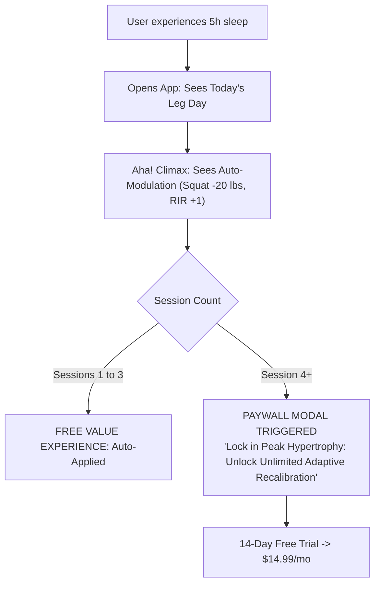

# Monetization Blueprint: Adaptive Hypertrophy Wedge

> **Directive Source**: Phase 4 of Founder Operating System (`pricing-strategy-architect`, `build-vs-sell`).  
> **Target Alignment**: The Structured Hypertrophy Trainee ("Alaa").  
> **Status**: APPROVED MONETIZATION ARCHITECTURE

---

## 💎 1. The Value Metric & Pricing Philosophy

### The Trap to Avoid
Do not charge for "AI tokens", "number of exercises stored", or basic logging. Basic logging is a commoditized utility (Hevy and Strong do it for free). Charging for logging creates immediate churn.

### The Core Value Metric
**"Biometric Program Recalibrations & Volume Autoregulation"**  
The lifter pays for the *intelligence that protects their nervous system, prevents injury, and guarantees progressive overload* without an expensive human coach ($200+/mo).

---

## 🏷️ 2. The Two-Tier Packaging Structure

```
+------------------------------------+------------------------------------+
| FREE / STARTER WEDGE               | PRO HIGH-PERFORMANCE               |
| $0 / Forever Free                  | $14.99 / month or $99 / year       |
+------------------------------------+------------------------------------+
| * Fast 5s Set Logger               | * EVERYTHING IN STARTER            |
| * Full Exercise Library            | * Dynamic Sleep/Fatigue Recalib.   |
| * Pre-filled Weight & Rep History  | * Meso-Cycle Volume Waves          |
| * Automatic Rest Timer             | * Personalized CNS Recovery Moat   |
| * Daily Supplement Checklist       | * Priority Feature Releases        |
+------------------------------------+------------------------------------+
```

---

## ⏱️ 3. Paywall Placement & The "Moment of Peak Perceived Value"



### The Exact Trigger Sequence:
1. **Never block the front door**: The user registers with zero payment friction.
2. **First 3 Recalibrations Free**: The user experiences 3 actual instances of fatigue-adapted training where the app saved them from missing reps or getting injured.
3. **The Lock-In**: On the 4th instance of sub-optimal readiness, the app previews the recommended adaptation blur:
   > **CNS Protection Guard**:  
   > *We detected high nervous system fatigue today. 2 volume adjustments calculated.*  
   > `[ Unlock Adaptive Coaching with 14-Day Free Trial — $14.99/mo ]`
4. **Degradation Fallback**: If the user declines, they are NEVER locked out of their workout. The app simply falls back to the unadjusted, static routine.

---

## ⚖️ 4. Build vs. Sell Allocation Rule

Under the [`build-vs-sell`](file:///C:/Users/rouca/.gemini/config/skills/build-vs-sell/SKILL.md) doctrine:
* **Weekly Limit**: No more than 20 hours of code per week.
* **Customer Distribution Mandate**:
  * 10 hours/week running Mom-Test interviews with hypertrophy lifters in local powerlifting/bodybuilding gyms and niche Discord/Reddit communities (e.g., r/weightroom, r/naturalbodybuilding).
  * Direct outreach: 20 personalized DMs per week to lifters actively complaining about Hevy/Strong rigidity.
