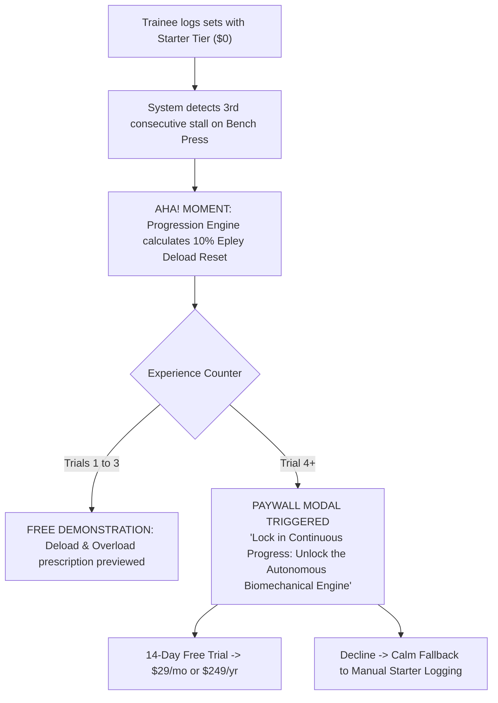

# Monetization Blueprint: Autonomous Biomechanical Engine

> **Directive Source**: Founder Operating System Framework (`pricing-strategy-architect`, `build-vs-sell`)  
> **Code-Level Synchronization**: `src/lib/entitlements.ts` Middleware & Capabilities  
> **Target Persona**: The Structured Hypertrophy Trainee ("Alaa")  
> **Status**: APPROVED MONETIZATION ARCHITECTURE  

---

## 1. The Value Metric & Pricing Philosophy

### The Commodity Trap to Avoid
Never charge for basic set logging, exercise storage, or static rest timers. Basic logging is a commoditized utility (Hevy, Strong, and paper spreadsheets provide it for free). Charging for manual logging creates immediate churn and destroys user acquisition.

### The Core Value Metric: Autonomous Biomechanical Intelligence
The trainee pays for the **autonomous intelligence that calculates progressive overload, prevents orthopedic injury, and adapts volume in real time** without the slow turnaround ($250+/month) of a human coach.

$$\text{Willingness-to-Pay Anchor} = \frac{\text{Human Biomechanics Coach (\$250–\$350/mo)}}{\text{VYRA Autonomous Engine (\$29/mo)}} \implies \mathbf{10\times \text{ Cost Arbitrage}}$$

---

## 2. The 3-Tier Packaging & Entitlement Structure

Directly synchronized with the production entitlement middleware in `src/lib/entitlements.ts`:

```
+------------------------------------+------------------------------------+------------------------------------+
| STARTER TIER                       | AUTONOMOUS TIER                    | VIP COACH CONCIERGE                |
| $0 / Forever Free                  | $29 / month (or $249 / year)       | $129 / month (Quarterly / Annual)  |
+------------------------------------+------------------------------------+------------------------------------+
| * Sub-5s Set Logging               | * EVERYTHING IN STARTER            | * EVERYTHING IN AUTONOMOUS         |
| * 6,554 OpenGym Catalogue Browser  | * Automated Progression & Deload   | * Asynchronous Dedicated Coach     |
| * 40+ Gym Floor Shorthand Search   | * Anatomical Tension Spotlight     | * Custom Curated 16-Week Mesocycle |
| * Barbell/Smith Plate Calculator   | * Intelligent Substitution Copilot | * Bi-Weekly Video Posture Audits   |
| * Daily Supplement Checklists      | * Structural Balance Radar UI      | * Priority Direct Concierge Line   |
| * Offline Floor Mode & Drafts      | * Biometric Sleep Autoregulation   | * Early Access to Future Horizons  |
+------------------------------------+------------------------------------+------------------------------------+
```

### Tier Feature Specifications

#### Tier 1: Starter ($0 / Free Forever)
- **Target**: Novice trainees and lifters evaluating Vyra's in-gym speed.
- **Entitled Features** (mapped to `TIER_CAPABILITIES.FREE` in `src/lib/entitlements.ts`):
  - `basic_workout_logging`: Ultra-fast sub-5s set logging with smart pre-filled history from previous sessions.
  - `catalogue_browsing`: Full, unrestricted access to all 6,554 OpenGym exercise definitions with sub-10ms search and 40+ gym floor shorthands (`db`, `bb`, `rdl`, `ohp`, `sm`, `abs`).
  - `plate_calculator`: Interactive `<PlateCalculatorPopover />` supporting Olympic 20kg, Women's 15kg, and Smith machines (0–15kg).
  - `stealth_gym_mode`: Distraction-free Obsidian dark UI (`#0B0F17`), Screen Wake Lock, and write-ahead IndexedDB offline storage.

#### Tier 2: Autonomous ($29/month or $249/year)
- **Target**: Serious lifters, corporate professionals, and strength athletes seeking automated sports science progression.
- **Entitled Features** (mapped to `TIER_CAPABILITIES.PRO` in `src/lib/entitlements.ts`):
  - **Everything in Starter**, plus:
  - `progression_engine`: Pure math progression suite (`progression.ts`) executing double progression, Greyskull LP, stall streak accumulation, and automated 10% Epley reset deloads.
  - `structural_balance_radar`: Poliquin, Thibaudeau, and ATG benchmark strength ratio radar and joint preservation analysis at `/posture`.
  - `autoregulation_advanced`: 1-tap sleep and readiness volume down-regulation (`<AdaptiveRecalibrationCard />`), axial compound load buffering, and machine volume shifts.
  - `gemini_biometric_synthesis`: 4-layer RAG context debrief, Coach Smart Action Cards (`<CoachSmartActionCard />`), and closed-schema program mutations.
  - **Anatomical Tension Spotlight**: Vector micro-torso SVG highlighting primary (Emerald `#10B981`) and synergist (Cyan `#06B6D4`) tension with dual kinetic anchors (⚡ **Setup Anchor** and 🎯 **Kinetic Drive**).
  - **Intelligent Substitution Copilot**: `<SubstitutionCopilotDrawer />` matching occupied gym equipment by muscular subdivision and resistance curve with automated load recalculation.
  - **Offline Sync Resilience**: Mutation replay queue with exponential backoff and jitter (`offline-sync.ts`).

#### Tier 3: VIP Coach Concierge ($129/month)
- **Target**: Executive athletes, competitive bodybuilders, and desk-bound professionals requiring individualized human oversight.
- **Entitled Features** (mapped to `TIER_CAPABILITIES.ENTERPRISE` in `src/lib/entitlements.ts`):
  - **Everything in Autonomous**, plus:
  - **Dedicated Biomechanics Coach Review**: Asynchronous 1-on-1 monthly program review and feedback from an accredited sports science specialist.
  - **Bespoke 16-Week Mesocycles**: Agentic RAG program drafts reviewed, refined, and personalized by the coaching staff.
  - **Video Form & Posture Audits**: Bi-weekly video analysis of compound lifts (Squat, Deadlift, Bench Press, Overhead Press) evaluating spinal alignment and bar trajectory.
  - **Direct Concierge Channel**: Priority in-app communication with guaranteed 12-hour turnaround.

---

## 3. Paywall Placement & The "Moment of Peak Perceived Value"



### The Exact In-App Trigger Sequence:
1. **Zero Upfront Friction**: The trainee enters `/today` or `/session` immediately without entering payment details.
2. **First 3 Recalibrations / Deloads Free**: The trainee experiences 3 live demonstrations of automated progression, deload triggers, or intelligent equipment substitutions that save their workout.
3. **The High-Value Paywall Modal**: On the 4th instance of advanced biomechanical intervention, the app displays the upgrade modal:
   > **Autonomous Biomechanical Engine**:  
   > *We detected 3 consecutive misses on Barbell Bench Press. Your 10% Epley Deload Reset and structural balance adjustments are ready.*  
   > `[ Start 14-Day Free Trial — $29/mo or $249/yr ]`  
   > *Secondary Action*: `[ Continue with Manual Set Logging ]`
4. **Calm Degradation Fallback**: If the trainee declines, they are **never locked out of their workout**. The app smoothly falls back to standard manual logging (`TIER_CAPABILITIES.FREE`).

---

## 4. Code-Level Entitlement Gating Architecture

Implementation in `src/lib/entitlements.ts` enforces feature boundaries at runtime:

```typescript
// Entitlement Verification Example
import { assertEntitlement, hasEntitlement, SubscriptionTier } from '@/lib/entitlements';

// 1. Guarding an API route (e.g. /api/posture)
export async function GET(request: Request) {
  const userTier: SubscriptionTier = getUserTier(request);
  
  if (!hasEntitlement(userTier, 'structural_balance_radar')) {
    return NextResponse.json(
      { error: 'Feature requires Autonomous Tier ($29/mo)', upgradeUrl: '/pricing' },
      { status: 403 }
    );
  }
  
  return NextResponse.json(await computeStructuralBalance(userId));
}

// 2. Client-side conditional render
const canAccessCopilot = hasEntitlement(user.tier, 'autoregulation_advanced');
```

---

## 5. Build vs. Sell Allocation Rule

Under the [`build-vs-sell`](file:///C:/Users/rouca/.gemini/config/skills/build-vs-sell/SKILL.md) founder doctrine:

- **Weekly Coding Ceiling**: Maximum 20 hours per week dedicated to source code modifications.
- **Customer Acquisition & Distribution Mandate**:
  - 10 hours/week conducting Mom-Test interviews with hypertrophy lifters in local gyms and specialized lifting communities (e.g. r/naturalbodybuilding, r/weightroom).
  - 20 personalized direct messages per week to lifters complaining about rigid spreadsheets or broken mobile trackers.
  - Weekly review of CAC (Customer Acquisition Cost), LTV (Lifetime Value), and conversion rates from Starter ($0) to Autonomous ($29/mo).
