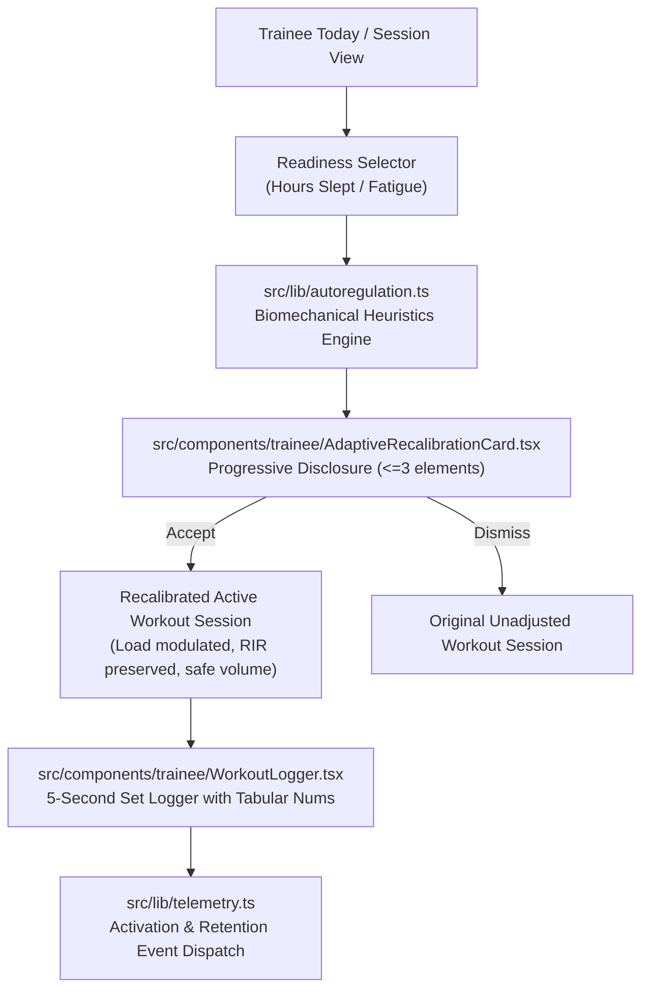

# Implementation Plan: Vyra Adaptive Hypertrophy Wedge

**Branch**: `007-adaptive-hypertrophy-wedge` | **Date**: 2026-09-24 | **Spec**: [spec.md](spec.md)

---

## 1. Architecture & Component Blueprint

---

## 2. Technical Context & Guardrails

- **Language / Runtime**: TypeScript 5.x, Node.js 24, Next.js 16.3 App Router, React 19.
- **Design Guardrails (`AGENTS.md` & `pencilplaybook`)**:
  - Vertical element ceiling: $\le 3$ elements per card.
  - Single dominant CTA (`bg-emerald-500` / accent).
  - 60-30-10 color hierarchy (`#0B0F17` surface, `bg-slate-900/60` card, emerald accent).
  - Strict `tabular-nums` formatting to prevent layout jitter.
  - Touch target floor: $\ge 44\times 44$px for all active gym logging controls.
- **Testing**: Node Test Runner (`node:test`) via `npm test`.

---

## 3. Implementation Steps

1. **Autoregulation Engine (`src/lib/autoregulation.ts`)**:
   - `ReadinessScore` calculation (0–100) based on sleep duration and fatigue.
   - Categorization: `optimal` ($\ge 7.5$h), `suboptimal` (5.5–7h), `depleted` ($< 5.5$h).
   - Biomechanical classification: Axial-loaded compounds (Squat, Deadlift, Overhead Press) vs Machine/Isolation (Hack Squat, Leg Curl, Lateral Raise).
   - Volume modulation rules:
     - Depleted: 8–10% load reduction on axial compounds, +1 RIR target, prune junk accessory sets or shift to machine.
     - Suboptimal: 4–6% load reduction on primary compound, +1 RIR target.
     - Optimal: 0% reduction, target RIR preserved, overload challenge highlighted.
   - Comprehensive test suite in `tests/unit/lib/autoregulation.test.ts`.

2. **Telemetry Layer (`src/lib/telemetry.ts`)**:
   - Standardized `trackEvent(name, properties)`.
   - Event types: `workout_preview_viewed`, `workout_recalibration_applied`, `workout_recalibration_dismissed`, `workout_set_logged`, `workout_completed`.
   - Test suite in `tests/unit/lib/telemetry.test.ts`.

3. **Adaptive Recalibration UI Component (`src/components/trainee/AdaptiveRecalibrationCard.tsx`)**:
   - 3-element card structure.
   - Before/After load & RIR diff chips.
   - Single dominant primary action + ghost cancel.

4. **Integration with Session & Today Flow**:
   - Embed recalibration state into `src/app/(trainee)/session/page.tsx`.
   - Pre-fill recalibrated numbers into the active workout logger.
   - Wire telemetry calls to set logging.
