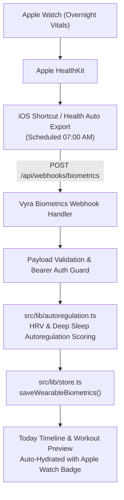

# Implementation Plan: Lightweight Apple Health Biometrics Webhook

**Branch**: `008-apple-health-biometric-webhook` | **Date**: 2026-09-27 | **Spec**: [spec.md](spec.md)

---

## 1. Architecture & Data Flow



---

## 2. Technical Context & Data Contracts

### 2.1 Ingestion Payload Schema
```typescript
export interface InboundBiometricsPayload {
  traineeId: string;
  secretKey?: string;
  date?: string; // YYYY-MM-DD (defaults to today)
  source?: "apple_health" | "whoop" | "oura";
  sleepHours: number;
  deepSleepMinutes?: number;
  remSleepMinutes?: number;
  hrvMs?: number; // Heart Rate Variability (SDNN or rMSSD)
  restingHeartRateBpm?: number;
  activeEnergyBurnedKcal?: number;
}
```

### 2.2 Security & Rate Limiting
- Webhook authenticated via Bearer Token header or `secretKey` field (configured via `BIOMETRICS_WEBHOOK_SECRET` environment variable with safe dev fallback).
- Sanitized payloads; zero personal identifiable data stored.

### 2.3 Biomechanical Scoring Enhancement
- Update `calculateReadinessScore` in `src/lib/autoregulation.ts` to accept optional `hrvMs`, `deepSleepMinutes`, and `restingHeartRateBpm`:
  - Suppressed HRV ($< 45$ms or $\ge 20\%$ below baseline): applies $-15$ readiness penalty.
  - Deficient Deep Sleep ($< 40$ min): applies $-10$ readiness penalty.
  - Elevated Resting Heart Rate ($+5$ bpm above baseline): applies $-5$ readiness penalty.

---

## 3. Implementation Steps

1. **Domain Types (`src/lib/types.ts`)**:
   - Define `WearableBiometricSnapshot`.
2. **Store Extension (`src/lib/store.ts`)**:
   - Add `biometricSnapshots: WearableBiometricSnapshot[]` to `AppDatabase`.
   - Implement `saveWearableBiometrics` and `getLatestWearableBiometrics(traineeId)`.
3. **Autoregulation Engine Extension (`src/lib/autoregulation.ts`)**:
   - Enhance readiness calculation with HRV and Deep Sleep inputs.
4. **API Webhook Handler (`src/app/api/webhooks/biometrics/route.ts`)**:
   - Implement `POST` and `GET` (for liveness verification).
   - Validates input, saves snapshot, returns readiness calculation and adaptations.
5. **UI Hydration (`src/app/(trainee)/session/page.tsx` & `src/app/(trainee)/today/page.tsx`)**:
   - Automatically initialize sleep state and display Apple Watch badge when a fresh snapshot exists.
6. **Unit Tests (`tests/unit/lib/biometrics-webhook.test.ts`)**:
   - Test payload ingestion, HRV scoring penalties, and store persistence.
