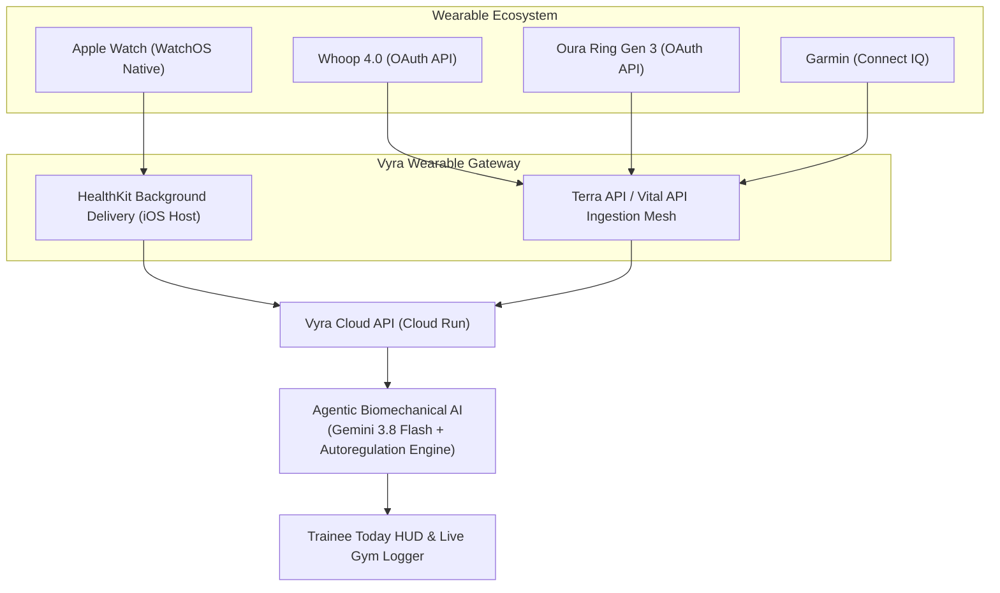

# Feature Specification: Vyra Native Apple Watch Ecosystem & Multi-Wearable Aggregator

**Feature Branch**: `009-apple-watch-native-ecosystem`  
**Created**: 2026-09-27  
**Status**: DRAFT (Phase 2 Full Release Specification)  
**Prerequisites**: Validation of [008-apple-health-biometric-webhook](file:///d:/rouca/DVM/workPlace/NewMe/specs/008-apple-health-biometric-webhook/spec.md) with active alpha cohorts.

---

## 1. Executive Summary & Vision

While Phase 1 (`008`) proves the value of automated morning readiness ingestion via webhooks, Phase 2 elevates Vyra into a **comprehensive wearable operating system** for serious athletes and high-performers.

Phase 2 introduces three core pillars:
1. **The Native WatchOS Wrist Companion App**: Trainees log workout sets directly from their wrist with zero phone dependency on the gym floor.
2. **The Multi-Wearable Unified Ingestion Mesh**: Instant 1-tap OAuth connection for **Apple Watch, Whoop 4.0, Oura Ring Gen 3, and Garmin** via a unified aggregator layer (Terra API / Vital API).
3. **Live Intra-Workout Autoregulation**: Autonomous intra-session adjustments based on live heart-rate recovery curves and HRV between working sets.

---

## 2. Core Functional Requirements

### 2.1 The Native WatchOS Companion App (SwiftUI & WatchConnectivity)
* **Wrist Set Logger**:
  * Displays current working exercise, target reps, and pre-filled load.
  * Digital Crown rotation for rapid $\pm 2.5$kg weight adjustments.
  * 1-Tap `[ Log Set ✓ ]` button with crisp haptic feedback (`WKHapticTypeSuccess`).
* **Haptic Rest Interval Engine**:
  * Countdown timer rendered as a circular ring on the watch face.
  * Progressive haptic taps at 5s, 3s, 1s, and a distinct double-pulse at 0s indicating next set readiness.
* **Stand-Alone Offline Mode**:
  * Trainees can leave their iPhone in the gym locker.
  * The watch caches up to 10 completed workouts and syncs automatically when reconnected to Wi-Fi/Bluetooth.

### 2.2 Multi-Wearable Unified Aggregator Mesh
* **1-Tap Device Connect Matrix**:
  * In `/you` or `/settings`, trainees toggle their wearable source:
    * Apple Health (Direct HealthKit background delivery)
    * Whoop 4.0 (Daily Recovery Score, Day Strain, Sleep Performance)
    * Oura Ring (Readiness Index, Temperature Deviation, HRV Balance)
    * Garmin Connect (Body Battery, Stress Score)
* **Unified Normalization Layer**:
  * Ingests heterogeneous metrics and normalizes them into Vyra's standard `AutoregulationPlan` score (0–100).

### 2.3 Agentic Intra-Workout Autonomic Copilot
* **Live Cardiovascular Recovery Tracking**:
  * If heart rate remains $> 135$ bpm at the expiration of a 90s rest interval, the agent automatically extends the rest timer by 30 seconds to prevent premature cardiovascular failure before myofibrillar failure.
* **Intra-Session Fatigue Cut-Off**:
  * If movement velocity or set recovery degrades by $> 25\%$ across consecutive sets, the agent triggers an intervention:
    > *"Systemic CNS fatigue peak reached on Leg Day. Final accessory sets pruned to avoid negative training adaptations."*

---

## 3. Architecture & Technical Strategy

---

## 4. Phased Milestones & Release Gates

1. **Gate 1**: 20+ active lifters retain for 30 days on Phase 1 (`008-apple-health-biometric-webhook`).
2. **Gate 2**: Multi-wearable aggregator contract (Terra / Vital) deployed and tested with Whoop & Oura.
3. **Gate 3**: Swift/WatchOS companion app submitted to Apple TestFlight.
