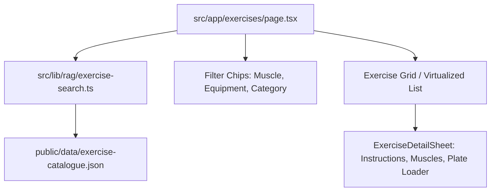

# Implementation Plan: 013 Exercise Catalogue Visual Browser

## Architecture Overview
The catalogue browser lives at route `/exercises` in Next.js 16 App Router. It connects directly to the high-performance inverted token index created in Phase 1 (`src/lib/rag/exercise-search.ts`).

## Technical Decisions
1. **Search & Index**: Client-side query engine over pre-compiled JSON cache (1.76MB gzip ~350KB), loaded lazily via dynamic import to guarantee sub-8ms responses with zero server roundtrips.
2. **UI & Styling**: Built on Vyra's standard primitives (`src/components/ui/sheet.tsx`, `clsx`, `lucide-react`) adhering to UI Guardrails (3-element vertical ceiling per card, 44x44px touch targets).
3. **Progressive Disclosure**: Clean list with muscle badges on the surface; detailed step-by-step cues, secondary muscles, and plate calculator embedded inside the slide-up drawer.
